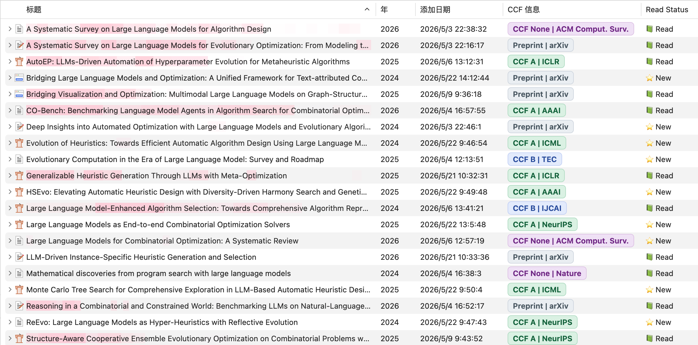
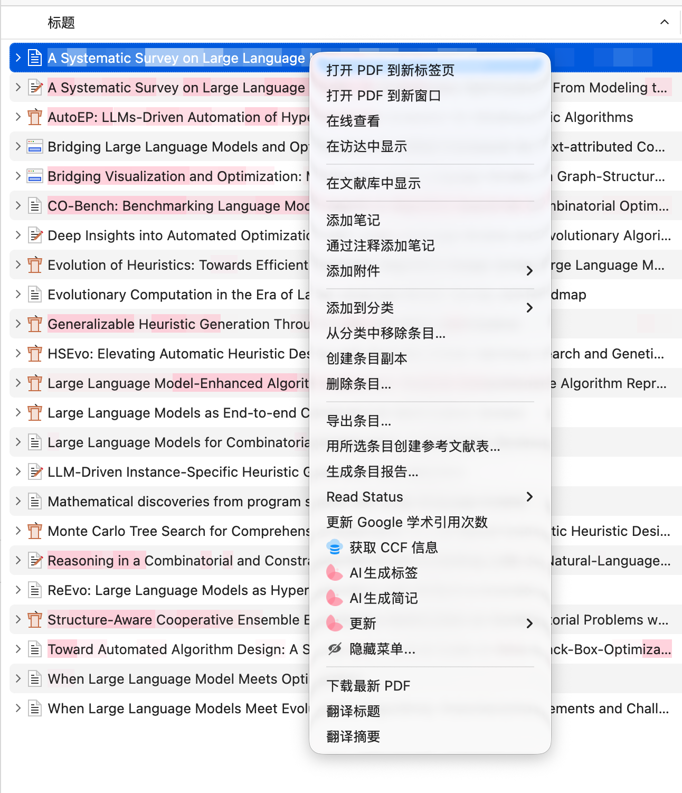

# Zotero CCF Plus

[](https://github.com/Fangziyang0910/zotero-ccf-plus/releases/latest)
[](LICENSE)

为 Zotero 文献显示 CCF 期刊/会议评级和 Semantic Scholar 引用次数。结果保存在文献的子笔记中，可通过列表列查看。

A Zotero plugin for CCF venue rankings and Semantic Scholar citation counts. Results are stored in a child note and displayed in optional library columns. See [English quick start](#english-quick-start).

## 兼容性

- 声明支持 **Zotero 7–10.0**，包括稳定版 Zotero 10 的兼容性检查。
- 本次实际验收环境：**macOS、Zotero 10.0.6**。其他系统和旧版本尚未在本次维护中进行实机验收，欢迎提供测试反馈。
- 当前维护版本：**0.3.4**。变更记录见 [CHANGELOG](CHANGELOG.md)。

## 安装与使用

1. 从 [Releases](https://github.com/Fangziyang0910/zotero-ccf-plus/releases/latest) 下载 `zotero-ccf-plus.xpi`，请勿下载源码压缩包代替插件。
2. 打开 Zotero 的 **工具 → 插件**，点击齿轮，选择 **Install Plugin From File… / 从文件安装插件**；不同 Zotero 版本的名称可能略有区别。
3. 选择 XPI 文件，确认插件已启用。升级后若界面尚未刷新，可重启 Zotero。
4. 选中一篇或多篇普通文献条目，右键选择 **获取 CCF 信息**。
5. 右键点击列表表头，勾选 **CCF 信息** 和 **CCF Plus 引用次数**。后者与 Zotero 自带或其他插件的“引用次数”列不同。

附件、笔记、回收站条目和只读文库不会执行更新。重复点击同一文献时会合并正在进行的查询；批量查询按顺序处理。新增个人文库条目默认会在约 10 秒的导入等待后自动查询。



_旧版界面截图；当前引用次数列的名称为“CCF Plus 引用次数”。_



### 结果如何保存

插件创建或更新标题为 **CCF Info & Citations** 的子笔记，包含可读表格和供列表列读取的 JSON 数据。正常更新只维护这一篇插件笔记，不修改 PDF、正文笔记或文献的出版物元数据。

| 显示               | 含义                                                     |
| ------------------ | -------------------------------------------------------- |
| `CCF A / B / C`    | 文献的出版会刊匹配到了内置目录中的评级                   |
| `CCF None`         | 检测到了会刊，但未匹配到内置评级；不代表对论文质量的判断 |
| `Preprint / arXiv` | 本地或检索结果指向 arXiv；不代表已核实其后续正式发表情况 |
| `Not Found`        | 当前元数据或检索结果不足以完成匹配                       |
| `Error: 429` 等    | 数据源暂不可用；已有的成功结果会保留                     |

### 数据来源与匹配规则

- **CCF 评级**：优先匹配 Zotero 中已有的会议名、出版物名、缩写、网址或 Extra 中的会刊字段；缺少可用元数据时，再尝试 Semantic Scholar 和 DBLP。
- **目录快照**：[`src/modules/ccfCatalog2026.ts`](src/modules/ccfCatalog2026.ts) 保存了从 `ccf.atom.im` 镜像整理的 2026 目录快照，并保留历史别名兼容。目录随插件发布，不会自动同步，也不保证完整或完全准确；正式使用请核对 [CCF 官方推荐目录](https://www.ccf.org.cn/Academic_Evaluation/By_category/)。
- **引用次数**：来自 [Semantic Scholar Academic Graph](https://www.semanticscholar.org/product/api)。优先尝试 DOI/arXiv 标识符，并校验规范化后的标题；标题搜索也要求规范化后相同，以减少短标题误匹配。
- 同一篇文献的成功匹配结果在内存中缓存 **5 分钟**，评级和引用查询共享这份结果。真实的 0 次引用会显示为 0；缺失值不会被当成 0。

## 故障排查与已知限制

### 引用次数没有更新 / HTTP 429

Semantic Scholar 公共接口可能限流，且可能存在共享出口的额度限制。插件会串行发送请求、限制请求间隔，并在 429 后至少暂停该服务 30 秒；这不能保证外部服务一定可用。请稍后重试。

CCF 本地匹配可以在离线时工作；没有本地元数据的查询还依赖网络。DBLP 通过第三方代理 `dblp.timetrap.workers.dev` 访问，代理也可能不可用。每次网络请求（含响应读取）的超时为 15 秒。错误、空结果或未找到的数据不会覆盖之前成功的评级或引用量；完成提示会说明有多少条目的信息未完整取得。

### 评级不正确

先检查条目的会议名称、出版物名称、期刊缩写和 Extra 中的会刊信息，再重新查询。不要把 arXiv 链接本身当成正式发表证据。若内置目录或别名有误，请提交包含会刊全称和官方目录来源的 issue/PR。插件目前不提供独立的手动评级编辑器。

### 列不显示或窗口重开后菜单消失

确认插件已启用，再在表头菜单中开启相应列。0.3.4 修复了重复窗口注册及卸载清理；仍有问题时请提供 Zotero 版本、系统版本、插件版本和复现步骤。

### 关闭自动查询

在 Zotero **设置 → 高级 → 配置编辑器**中，将 `extensions.zotero.ccfplus.enable` 设为 `false`。该选项控制新增条目的自动查询，右键手动查询仍可使用。

## 隐私与网络访问

在线查询会将论文标题，以及可用的 DOI/arXiv 标识符发送到 Semantic Scholar；DBLP 回退查询会将规范化后的标题发送到上述第三方代理。插件不上传附件、PDF 内容或笔记正文。不希望新增条目自动查询时，请关闭自动查询。查询结果保存在本地 Zotero 文库，之后是否同步由 Zotero 自身的同步设置决定。

## 开发与贡献

需要 Node.js 22 或更新版本。依赖由 `package-lock.json` 锁定：

```sh
npm ci
npm run check
npm run build
```

生成的 XPI 和更新清单位于 `build/`。`npm test` 运行不依赖外部服务的回归测试；这些测试验证请求处理、数据匹配、笔记合并和生命周期逻辑，不代替实机测试。完整贡献流程和验收步骤见 [CONTRIBUTING](CONTRIBUTING.md)。

测试、检查和构建在本机执行。发布标签不会触发 GitHub 自动化；手动上传同次构建的 XPI 和 Zotero 更新清单。

报告问题请使用 [Issues](https://github.com/Fangziyang0910/zotero-ccf-plus/issues)，请去除 API 密钥、私人文献内容等敏感信息。请勿将整个 Zotero 文库上传到 issue。

## English quick start

1. Download `zotero-ccf-plus.xpi` from [Releases](https://github.com/Fangziyang0910/zotero-ccf-plus/releases/latest).
2. In Zotero, open **Tools → Plugins**, use the gear menu to install the XPI, and confirm that it is enabled.
3. Select regular items and choose **Get CCF Info** from the context menu. Enable **CCF Info** and **CCF Plus Citations** in the column header menu.

The declared compatibility range is Zotero 7–10.0. This maintenance pass is tested on macOS with Zotero 10.0.6; other platforms need independent testing. Rankings use bundled venue data, local metadata, Semantic Scholar, and a third-party DBLP proxy. Citation counts come from Semantic Scholar, which may rate-limit requests. Matching is conservative; missing data is not zero, and unsuccessful refreshes preserve previous successful values. A progress message reports incomplete lookups. Successful remote matches are cached in memory for five minutes.

Online lookups send titles and available DOI/arXiv identifiers to the services described above. PDF contents and notes are not uploaded by the plugin. Automatic lookups for newly imported personal-library items are enabled by default; set `extensions.zotero.ccfplus.enable` to `false` in Zotero's Config Editor to disable them. Manual refresh remains available.

For development, run `npm ci`, `npm run check`, and `npm run build`. See [CONTRIBUTING](CONTRIBUTING.md) for regression tests and manual acceptance checks.

## 致谢与许可证

感谢 [windingwind/zotero-plugin-template](https://github.com/windingwind/zotero-plugin-template)、[TimeTrapzz](https://github.com/TimeTrapzz)、[tojunfeng](https://github.com/tojunfeng)，以及提交问题和兼容性反馈的贡献者。

本项目使用 [AGPL-3.0-or-later](LICENSE) 许可证。CCF、Semantic Scholar、DBLP 及镜像数据的相关权利归各自权利人所有。
